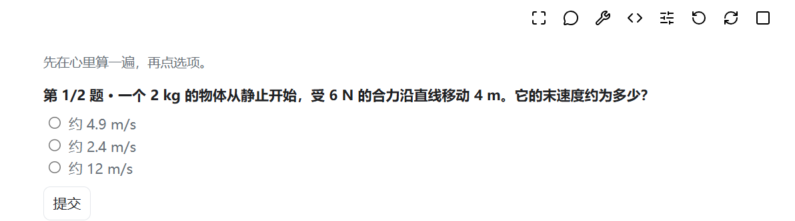
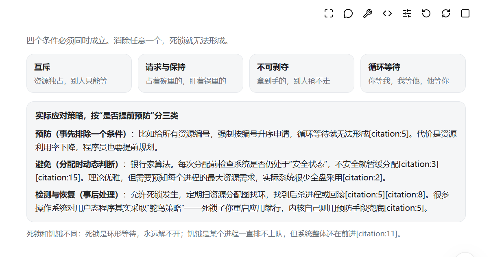
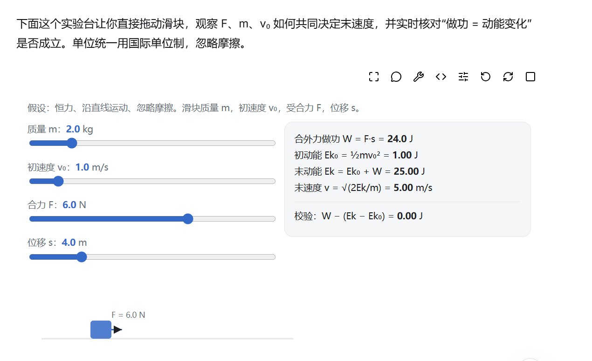
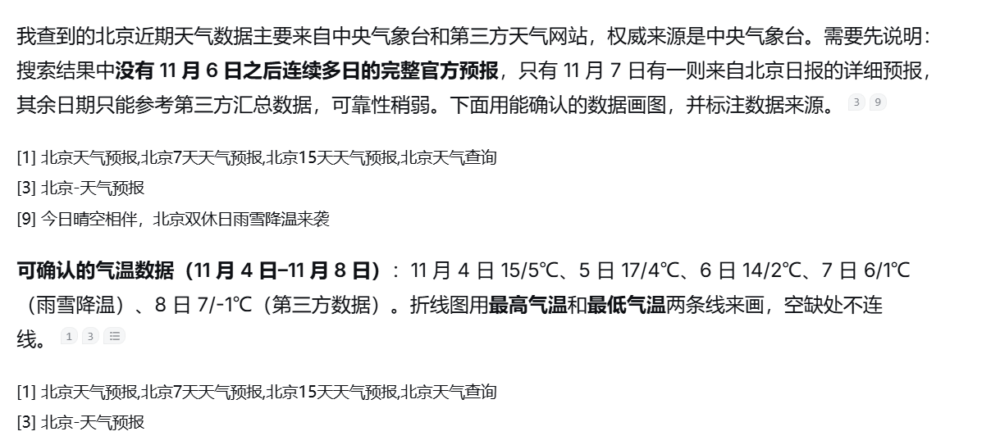
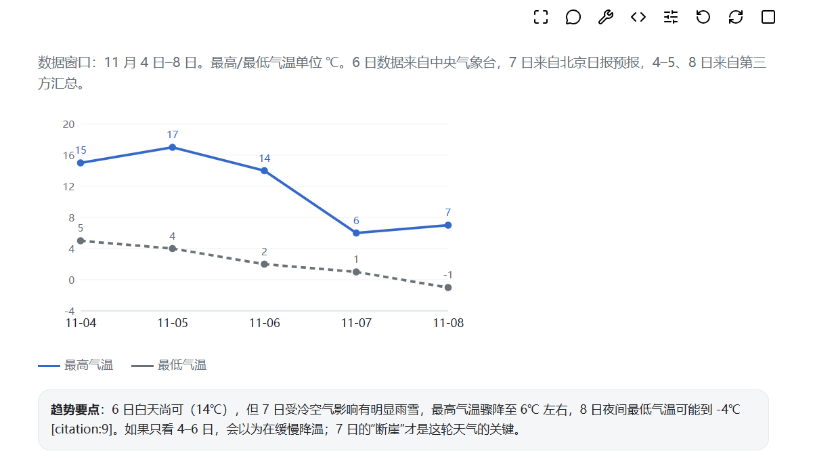

# More GenUI

一个可以让你在DeepSeek中体验到GPT的Intelligent UI的小插件

想试可编辑文法、自动机或离线教学卡？见 [1.4 候选版用法与验收](docs/releases/v1.4.0-rc.1.md)。

先来看看部分已经支持的UI！



*交互式小测验*



*知识卡片*



*交互式滑块*



*搜索引用*



*统计图*

梁圣来不及做的C端体验我们来改善！

## 快速开始

你可以本地构建，也可以直接从Release下载。如果你拿到了压缩包：

1. Edge 打开 `edge://extensions`；Chrome 打开 `chrome://extensions`。
2. 开启“开发人员模式”，选择“加载解压缩的扩展”，选中刚才的目录。
3. 回到已经登录的 DeepSeek 页面，刷新。右下角会出现电源图标，悬停可以看到当前开关状态。
4. 试试提问一下

如果你是在本地构建的项目，加载 `.output/chrome-mv3` 即可。这

如果你已经安装了扩展要升级或者已经打开了DeepSeek网页，**你还要刷新 DeepSeek 页面。** 

不知道测点什么？这里有一份 [测试提示词清单](docs/test-prompts.md)，数学、算法、电路、计划安排都有，挑你感兴趣的就行。

## 原理

扩展会在请求里附加一段生成规范，告诉模型如何输出 `genui-html`。（人话：提示词注入）

模型返回符合协议的 HTML/CSS/JavaScript 后，扩展在隔离的 iframe 中运行它。（人话：我们提供了组件，大肥鱼生成的代码可以直接解释）

聊天正文随你提交的问题发给 DeepSeek。新装默认显示文字来源。手动开启图文后，扩展会访问来源页和封面，目标站点能看到 IP 和访问时间；取图请求省略 Cookie 和 Referer。教学卡在离线沙箱里运行。

模型可以一边解释，一边插入几块小 UI。每块代码不必等整段回答结束，只要围栏完整后就能启动。如果Deep Seek流式输出中断就不会渲染。

滑块、按钮和动画在本地运行。参数会按宿主、会话、消息（或工具调用）、应用 ID、同名出现次序和状态版本隔离。

## 图标说明

每个渲染好的UI右上方都会有一排操作，我们采用 [Lucide](https://lucide.dev/) 图标。

| 操作     | 预期效果                                                     |
| -------- | ------------------------------------------------------------ |
| 放大     | 放大同一个 iframe，收回来时不重新创建应用                    |
| 继续询问 | 把当前参数填入输入框，**由你决定是否发送**                   |
| 修复     | 请求模型修复当前应用；已有草稿时不覆盖，站点不接受自动发送时保留草稿并提示 |
| 查看源码 | 在应用下方展开源码，不把工具栏拉成长条                       |
| 实验工具 | 保存与恢复快照、锁定对照组、导出参数与已登记的结果           |
| 重置     | 清空这个应用保存的参数，并重新启动                           |
| 重新运行 | 保留当前参数，重新启动应用                                   |
| 停止     | 停掉当前应用，保留参数                                       |

## 常见问题

**看不到右下角开关？**

先确认扩展已启用，当前网址是 `https://chat.deepseek.com/`，然后刷新页面。

**回答里只有代码，没有界面？** 

请耐心等待流式输出结束。不行就试试重启大法（当然是浏览器）。还不行那就来提Issue

**页面更新后突然不能用了？** 

DeepSeek 的页面结构和流式接口不是稳定公开 API，网站改版可能影响适配。欢迎来提Issue。~~当然，你可以先吐槽一句~~

**图算错了？** 

能运行和算得对是两回事。先检查输入、单位和数学假设，再决定是否点修复。这不是我们的锅，请找大肥鱼算账

## 关于DSH

插件位于 `packages/harness`，当前锁定 **Harness `0.2.1-rc.5` / Cordis `4.0.5`**。

在项目根目录执行 `pnpm build`，然后对已经配置好模型的 Web profile 安装插件。下面使用这台开发机的路径，换机器时记得改：

```powershell
dsh plugin --profile web add <你的路径>
```

随后重启 `dsh web` 并刷新前端。模型通过 `render_app` 工具提交源码，工具做验证和结果记录。具体见 [Harness 插件说明](packages/harness/README.md)。

## 本地开发

开发环境使用 Node 24、pnpm 10，依赖由 `pnpm-lock.yaml` 锁定。在项目根目录打开终端：

```powershell
pnpm install --frozen-lockfile
pnpm check
pnpm build
```

构建完成后，扩展在 `.output/chrome-mv3`，Harness 插件在 `packages/harness/lib`。`pnpm dev` 可以启动扩展开发流程。

测试按需要运行，日常改个文案不用把浏览器矩阵拉出来陪跑：

```powershell
# 协议、状态和 Harness 工具服务的快速测试
pnpm test

# 当前单行工具栏的 Edge 专项回归
pnpm exec playwright test tests/browser/inline.spec.mjs --project=Edge
```

需要运行 Chromium 测试时，先准备测试浏览器。下面是 PowerShell 写法：

```powershell
$env:PLAYWRIGHT_BROWSERS_PATH="$PWD\.cache\browsers"
pnpm exec playwright install chromium
pnpm exec playwright test --project=Chromium
```

`pnpm test:e2e` 会运行配置中的 Chromium 和本机 Edge 测试，`pnpm verify` 则串联检查、构建和测试。

想在本地看示例，可以运行 `node tests/browser/server.mjs`，然后打开 `http://127.0.0.1:4173`。

## 输出协议

围栏语言必须是 `genui-html`，第一行是元数据，后面是完整 HTML。例如：

````markdown
```genui-html
<!-- more-genui: {"version":1,"id":"wave","title":"波形实验","stateVersion":1} -->
<html><body>…完整界面、样式和脚本…</body></html>
```
````

应用通过 `genui.getState()` 读取参数，通过 `genui.setState(JSON对象)` 保存。源码上限 256 KiB，状态上限 64 KiB。

同一应用的兼容修改保留 `id` 和 `stateVersion`，状态结构不兼容时会增加版本。

